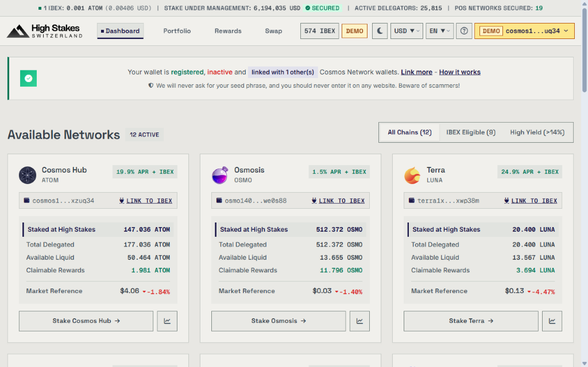
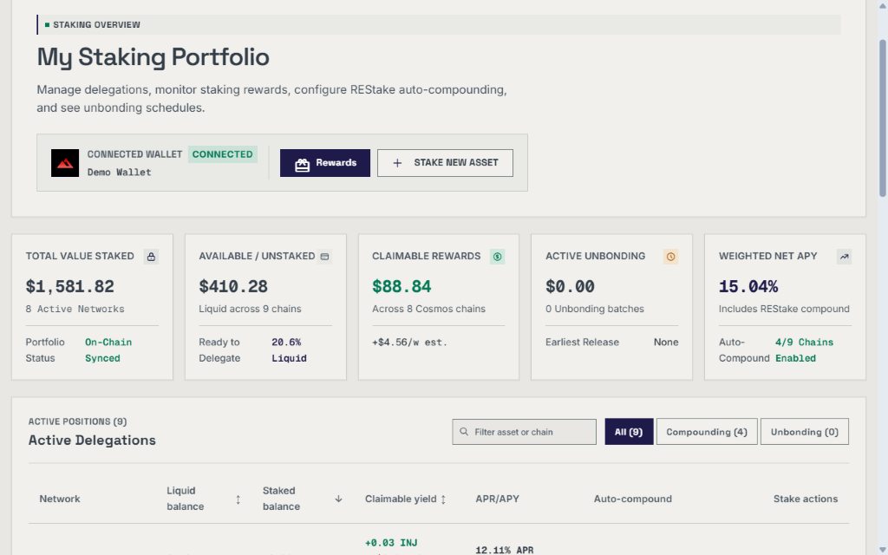

# Introduction

## Requirements
:::info
* A supported Cosmos wallet: **Keplr Wallet** (browser extension or mobile app), **Mobile Wallet** (via WalletConnect / Reown), **MetaMask** (via Cosmos Snap), or **Social Account** (via Web3Auth)
* One or more wallets delegating at least **$500 USD** in total to **High Stakes 🇨🇭** validators across our eligible chains
:::

## The IBEX Loyalty Program

With the **IBEX Loyalty Program**, <a href="https://highstakes.ch" target="_blank">High Stakes Switzerland</a> delegators boost their staking returns by earning a daily share of our validator yield across all eligible networks.

IBEX loyalty points are distributed daily to registered users based on the total USD value of tokens staked with High Stakes validators.

:::tip Key Program Highlights
- **Daily Accrual**: Users earn IBEX loyalty points every day (allocated between 15:00 and 15:30 UTC).
- **Redeem in `$ATOM` or `$USDC`**: Once you hold at least **50 IBEX**, you can redeem your points anytime on the **Rewards** page and choose to receive either liquid **`$ATOM`** or **`$USDC`** directly in your Cosmos Hub wallet:
  - If you redeem **250 IBEX or more**, the disbursement is processed immediately.
  - If you redeem between **50 and 249 IBEX**, the request is queued into an asynchronous multisend transaction that executes automatically as soon as total queued redemptions reach 250 IBEX (typically within a couple of hours).
- **Conversion Rate**: The baseline conversion rate is **1,000 IBEX = 1 ATOM** (`1 IBEX = 0.001 ATOM`), displayed live in the top header ticker alongside its current fiat value (`USD`, `CHF`, or `EUR`).
:::

## Supported Networks (12 Chains)

On <a href="https://app.highstakes.ch/dashboard" target="_blank">app.highstakes.ch</a>, you can filter networks by **All Chains (12)**, **IBEX Eligible (9)**, or **High Yield (>14%)**:

### 9 IBEX-Eligible Chains (`+ IBEX` Badge)
Delegations to High Stakes on these 9 networks count toward your $500 USD minimum threshold and generate daily IBEX points once linked:
1. **Cosmos Hub** (`ATOM`)
2. **Osmosis** (`OSMO`)
3. **Terra 2.0** (`LUNA`)
4. **Secret Network** (`SCRT`)
5. **Injective** (`INJ`)
6. **Fetch.ai** (`FET`)
7. **Band Protocol** (`BAND`)
8. **Shentu** (`CTK`)
9. **Akash Network** (`AKT`)

### 3 Additional Staking Chains
These networks are fully supported for in-app staking, portfolio tracking, and REStake auto-compounding (excluded from IBEX point calculation):
10. **MediBloc / Panacea** (`MED`)
11. **Axone** (`AXONE`)
12. **Provenance** (`HASH`)

## How It Works

1. **Connect & Register**: Connect your wallet on <a href="https://app.highstakes.ch" target="_blank">app.highstakes.ch</a> and register your account. Your IBEX account is identified by your primary **Cosmos Hub** (`cosmos1...`) address.
2. **Link Eligible Chains**: On the **Dashboard**, enable any network you stake on and click **`LINK TO IBEX`** on the chain card so your delegations on that network are linked to your IBEX account.
3. **Stake at Least $500 USD**: Any delegator can register, and daily IBEX points begin accruing automatically as soon as your combined stake across linked chains and wallets reaches at least **$500 USD**.
   - Once registered, the top status banner on the Dashboard displays your live **IBEX Earning Activity** status (**`active`** if your account earned IBEX within the last 48 hours, or **`inactive`** if your total linked stake is below $500 USD).
4. **Fair Daily Distribution**: Daily IBEX points vary with delegation balances and market exchange rates. A **quadratic function** (proportional to the square root of your staked USD value, capped at 250 IBEX/day per account) ensures fair distribution so large "whales" do not capture a disproportionate share of the daily pool.
5. **Redeem Anytime**: On the **Rewards** tab (`/rewards`), click **`Redeem IBEX`** to receive either **`$ATOM`** or **`$USDC`** in your Cosmos Hub wallet.

**Important note on point expiration**: IBEX points have a **60-day shelf life**—points awarded more than 60 days ago expire if unredeemed, **only when your available balance exceeds 500 IBEX**. <u>Below 500 IBEX, your points never expire</u>. We recommend redeeming your IBEX at least once every two months.

## Portfolio & Inline Stake Management

Beyond tracking IBEX loyalty points, the High Stakes app includes a full **Portfolio** control center (`/overview`) and an inline **Stake Management Workstation**:

- **5-Card KPI Deck**: Monitor your **Total Value Staked**, **Available / Unstaked** liquid balance, **Claimable Rewards** (with weekly estimate), **Active Unbonding** schedules, and **Weighted Net APY**.
- **Inline Stake Management Workstation**: Click **`Stake <Chain>`** on any Dashboard card or **`MANAGE`** / **`STAKE NEW ASSET`** in your Portfolio to **Delegate**, **Redelegate**, **Unbond**, or **Cancel Unbond** directly in the app.
- **Downtime Slashing Protection**: High Stakes maintains self-funded, publicly auditable on-chain escrow reserve wallets across 10 networks (verifiable directly from the bottom of the Dashboard) to cover downtime and jailing penalties.

## Multiple Wallets Support

For security reasons, many delegators use separate wallets or hardware seed phrases for different tokens.

Suppose you delegate across three separate wallets (different seed phrases):
- **$400 USD** worth of ATOM on Wallet A,
- **$300 USD** worth of INJ on Wallet B,
- **$100 USD** worth of BAND on Wallet C.

Individually, none of these wallets reaches the $500 USD threshold. However, by **linking your registered Cosmos wallets**, their delegations are aggregated:

- **400 + 300 + 100 = 800 USD** in total staked value.

Your combined stake exceeds $500 USD, and all daily IBEX points are credited to your primary wallet. Head to the [Linking Multiple Wallets](/loyalty-program/link/) guide to learn how.

## Rewarding Long-Term Stakers

Each year in December, a variable bonus pool of ATOM is distributed to loyal participants, prorated to the IBEX points earned over the past year and the number of days they continuously delegated to High Stakes.
