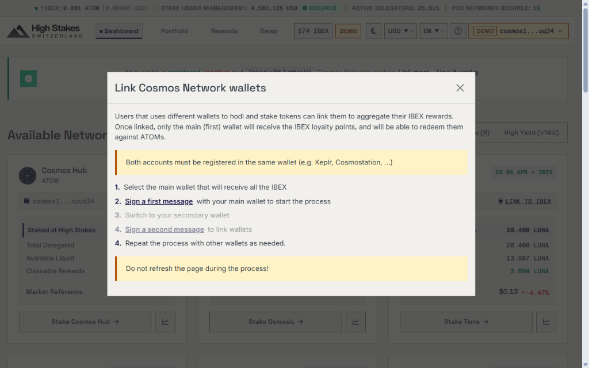
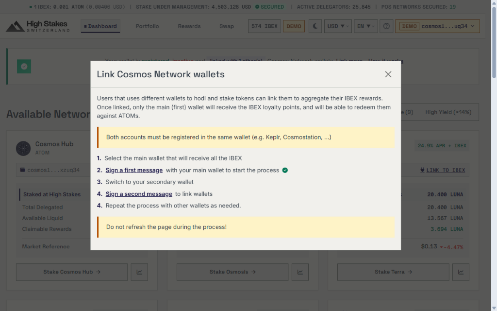

# Linking Multiple Wallets

If you stake from multiple wallets (i.e., separate seed phrases or accounts), you can link them together so their staked amounts are aggregated for your daily IBEX calculation. This is especially useful when each individual wallet stakes less than the **$500 USD** minimum required to earn IBEX points.

Once linked, all daily IBEX points generated across your linked wallets are credited to your **primary (first) wallet**, which you can use to redeem them for **$ATOM** or **$USDC**.

:::info Prerequisites
* Both wallets must already be **registered** in the IBEX Loyalty Program (and have their respective chains linked via **`LINK TO IBEX`**).
* Both accounts must be loaded inside the same browser extension wallet (such as **Keplr Wallet** on desktop, or the **Keplr Mobile** in-app browser) so you can switch from the primary account to the secondary account without refreshing the page.
:::

## How to Link Your Wallets

1. Connect your **primary wallet** (the main account that will receive all IBEX points) on <a href="https://app.highstakes.ch/dashboard" target="_blank">app.highstakes.ch</a>.
2. In the green wallet status banner at the top of the **Dashboard**, click **`link`** (or **`Link more`** if you already have a linked wallet) to open the **Link Cosmos Network wallets** modal.
3. Click **`Sign a first message`** (Step 2 in the modal) and approve the signature request in your primary wallet.

4. Once Step 2 shows a green checkmark, open your wallet extension and **switch to your secondary wallet** (Step 3). **Do not refresh the page during this process.**
5. Click **`Sign a second message`** (Step 4 in the modal) and approve the signature with your secondary wallet to confirm the link.

6. A confirmation message will confirm that your two wallets are now linked! Repeat the process if you wish to link additional wallets. 🚀

:::tip Viewing Your Linked Wallets
Once linked, the Dashboard status banner displays a badge showing **`linked with X other(s)`**. Hover over (or tap) this badge at any time to see the full list of Cosmos addresses linked to your account.
:::

If you have any questions or need further assistance, please don't hesitate to contact us on [Discord](https://discord.gg/Rw4YswvKVa) or [Telegram](https://t.me/HighStakesSwitzerland).
