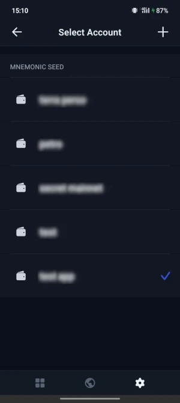
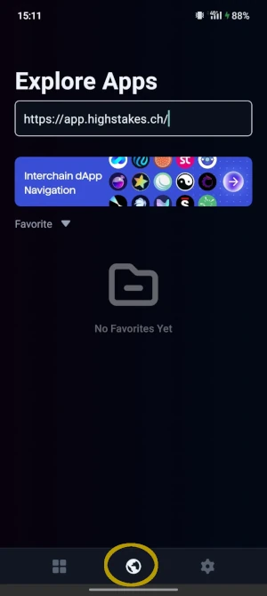
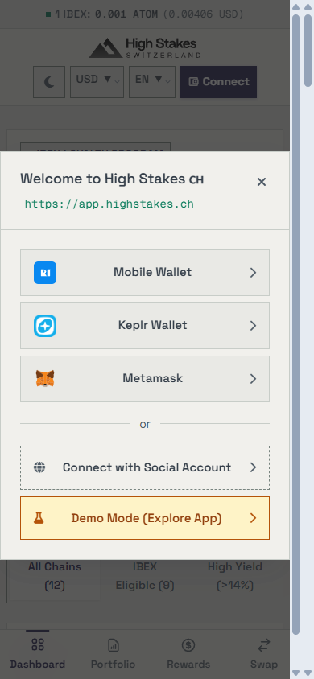
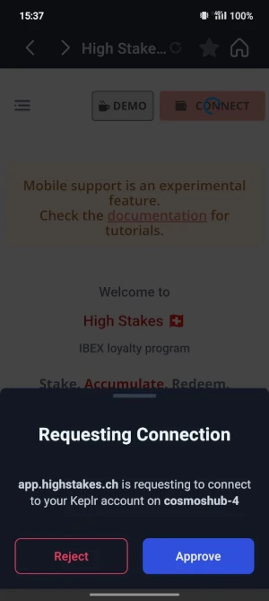
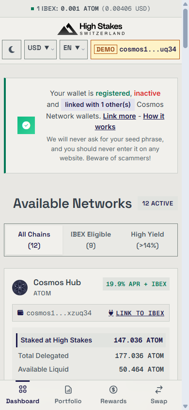

# Mobile & Alternative Wallet Support

`app.highstakes.ch` features a responsive mobile layout with a dedicated bottom navigation bar (**Dashboard**, **Portfolio**, **Rewards**, **Swap**) and supports multiple ways to connect from mobile devices or alternative wallets.

## Connection Options on Mobile

:::info Supported Mobile Workflows
1. **Mobile Wallet (WalletConnect / Reown)**: Open <a href="https://app.highstakes.ch" target="_blank">https://app.highstakes.ch</a> in your mobile browser (Safari, Chrome, Brave) or on desktop, tap **Connect**, and select **Mobile Wallet** to connect via WalletConnect v2 / Reown deep link or QR code.
2. **Keplr Mobile In-App Browser**: Open <a href="https://app.highstakes.ch" target="_blank">https://app.highstakes.ch</a> directly inside the built-in browser of the <a href="https://www.keplr.app/download" target="_blank">Keplr Mobile</a> app and select **Keplr Wallet**.
3. **Social Account (Web3Auth)**: Tap **Connect** -> **Connect with Social Account** to sign in with your social credentials from any device.
:::

## Option 1: Using Keplr Mobile In-App Browser

1. From the **Keplr Mobile** app, select the wallet account you want to use:

2. Open the **Browser** tab at the bottom of the app, type `https://app.highstakes.ch`, and press Enter:

3. Tap the **Connect** button in the top-right header, choose **Keplr Wallet** (or **Mobile Wallet**), and approve the connection request:

4. You are now connected! Use the bottom navigation bar to switch between **Dashboard**, **Portfolio**, **Rewards**, and **Swap**, and bookmark the page for quick access:

## Option 2: Connecting via Mobile Wallet (WalletConnect / Reown)

If you prefer browsing in your phone's native browser (or connecting your mobile wallet to a desktop browser session):

1. Navigate to <a href="https://app.highstakes.ch" target="_blank">https://app.highstakes.ch</a> and tap **Connect**.
2. Tap **Mobile Wallet** at the top of the connection modal.
3. On mobile, select your installed Cosmos wallet app via deep link; on desktop, scan the displayed QR code from your mobile wallet app and approve the session.

:::caution Linking Multiple Wallets on Mobile
Linking two separate Cosmos wallets requires switching accounts mid-session. Because WalletConnect / Reown mobile sessions do not allow hot-swapping accounts without disconnecting, multi-wallet linking should be performed once using the **Keplr desktop browser extension** (or inside the **Keplr Mobile** embedded browser by switching accounts in the app and returning to the browser tab).
:::
