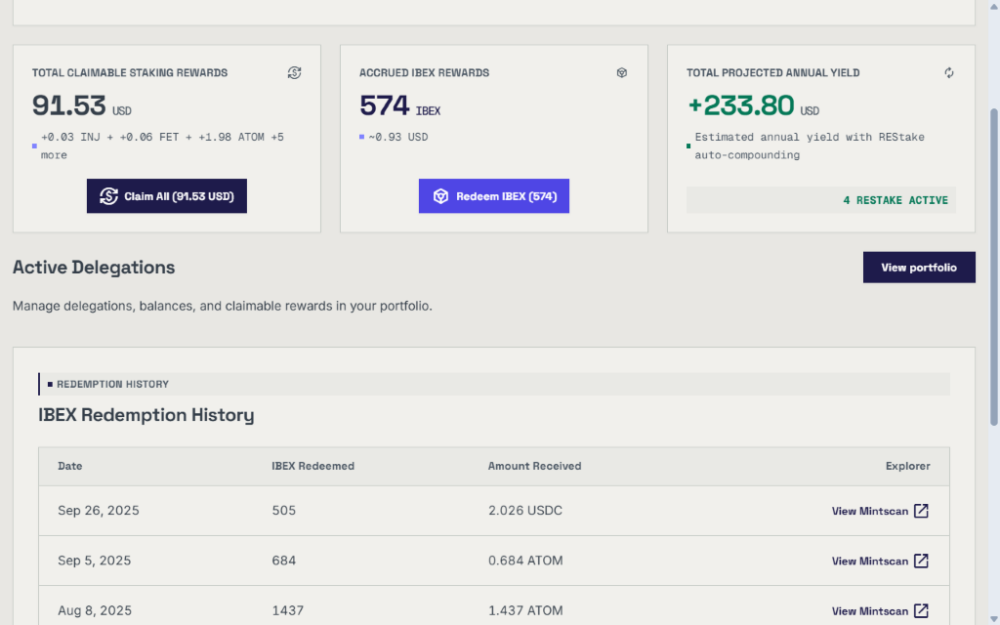
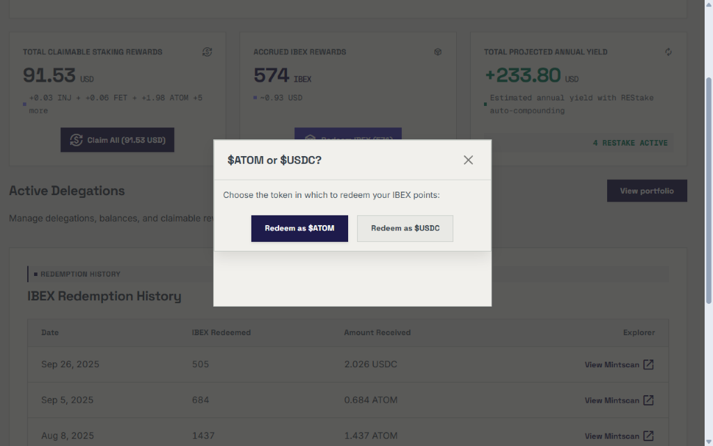

# Redeeming IBEX Points & Claiming Staking Rewards

The **Rewards** hub (`/rewards`) lets you both batch-claim your on-chain staking rewards across all connected networks and redeem your accrued **IBEX** loyalty points for either **`$ATOM`** or **`$USDC`**.

## 1. Go to the "Rewards" Tab

When you have accrued at least **50 IBEX** points, navigate to the **Rewards** tab in the top navigation bar (or click directly on your **IBEX balance badge** in the header).

The **Rewards** page features three summary cards and your historical ledger:
- **Total Claimable Staking Rewards**: Displays the combined fiat value and token breakdown of your pending on-chain staking rewards across all connected Cosmos chains. Click **`Claim All`** to batch-withdraw your staking rewards in one workflow.
- **Accrued IBEX Rewards**: Displays your available IBEX balance and its estimated fiat value. When your balance is **50 IBEX or higher**, the **`Redeem IBEX (<amount>)`** button becomes active (below 50 IBEX, a `MIN. 50 IBEX REQUIRED` badge is displayed).
- **Total Projected Annual Yield**: Shows your estimated annual yield with REStake auto-compounding and how many chains currently have active REStake grants.
- **IBEX Redemption History**: A paginated ledger listing every past IBEX redemption (Date, IBEX Redeemed, Amount Received in `ATOM` or `USDC`, and a direct **View Mintscan** transaction link).

## 2. Choose `$ATOM` or `$USDC` & Redeem

1. Click the **`Redeem IBEX (<amount>)`** button on the **Accrued IBEX Rewards** card.
2. The **`$ATOM or $USDC?`** dialog opens, allowing you to choose the token in which to receive your payout:
   - Click **`Redeem as $ATOM`** to receive Cosmos Hub `ATOM`.
   - Click **`Redeem as $USDC`** to receive `USDC`.
3. Approve the free off-chain verification signature in your wallet to submit your redemption request.

## 3. Receive Your Payout

A 3-step progress bar tracks your redemption (`Waiting for wallet...` -> `Submitting transaction...` -> `Transaction is being processed...`):

- **250 IBEX or more (Immediate Redeem)**: The transaction is broadcast immediately and your `$ATOM` or `$USDC` arrives in your Cosmos wallet within seconds, followed by a confirmation dialog with a direct **Mintscan** transaction link.
- **50 to 249 IBEX (Asynchronous Multisend Redeem)**: You can redeem starting from 50 IBEX; your payout is batched into a *multisend transaction* that executes automatically as soon as total queued redemptions exceed 250 IBEX (typically within a couple of hours).

## 4. Cross-Chain Swap (`/swap`)

Need to swap your newly claimed staking rewards or redeemed `$ATOM` / `$USDC` into another Cosmos asset?
Open the **Swap** tab (`/swap`) in the top navigation bar to use the integrated **Atom Circuit Swap** console (powered by Osmosis DEX liquidity and Cosmosrescue) without leaving `app.highstakes.ch`.
