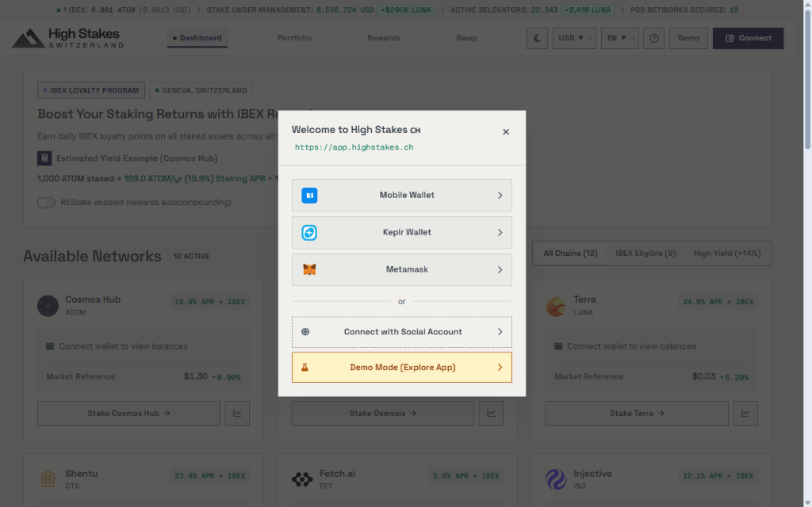
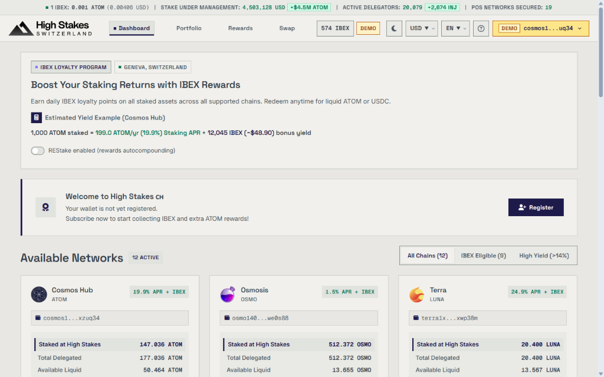
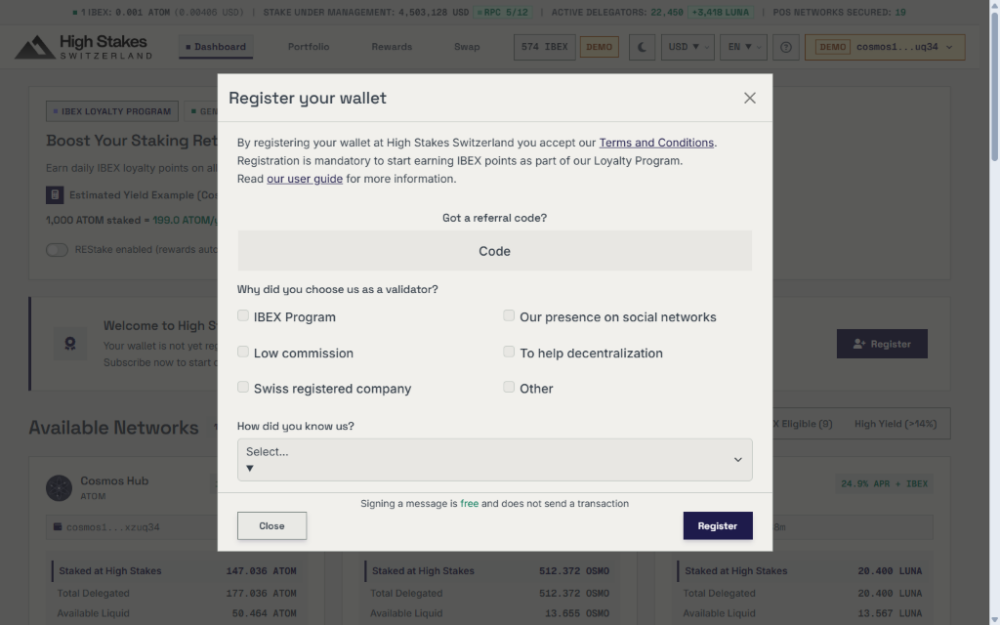
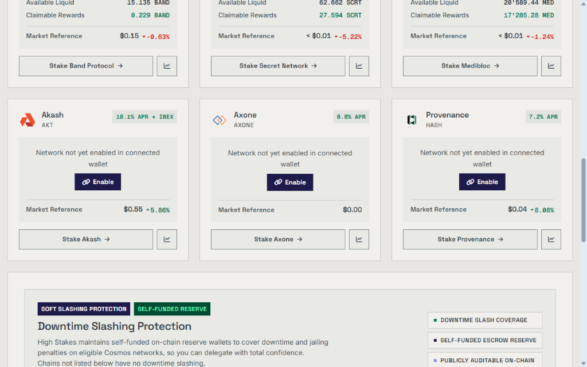
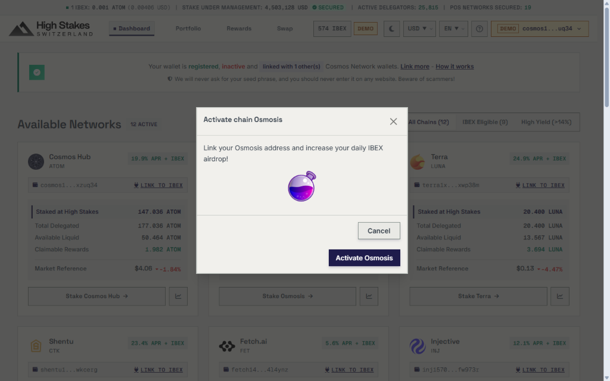
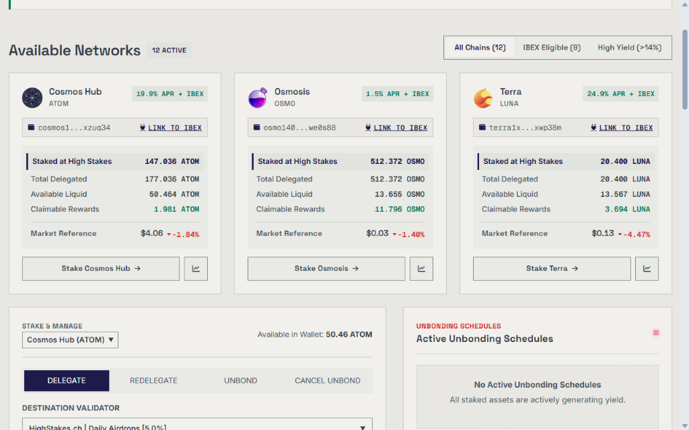

# Registration & Linking Chains

## 1. Connecting Your Wallet

To get started, go to <a href="https://app.highstakes.ch" target="_blank">https://app.highstakes.ch</a> and click the **Connect** button in the top-right header.

In the **Welcome to High Stakes 🇨🇭** modal, choose your preferred connection method:
- **Mobile Wallet**: Connect any WalletConnect v2 / Reown-compatible mobile wallet via QR code or deep link.
- **Keplr Wallet**: Connect using the Keplr browser extension (supports Ledger hardware wallets, including Injective Ledger signing).
- **Metamask**: Connect using MetaMask via the Leap Cosmos Snap integration.
- **Connect with Social Account**: Sign in with a social account via Web3Auth.
- **Demo Mode (Explore App)**: Explore the entire application with live sample delegations in read-only mode (also accessible directly via the **Demo** button in the header).

:::tip Interface Preferences
From the top-right header bar, you can switch between **Light and Dark mode**, choose your preferred display currency (**`USD`**, **`CHF`**, or **`EUR`**), and switch the interface language between **English (`EN`)** and **French (`FR`)**.
:::

## 2. Registering Your Wallet

Once your wallet is connected, if it is not yet registered in the IBEX Loyalty Program, a **Welcome to High Stakes 🇨🇭** registration banner appears below the IBEX Loyalty Program overview. Click the **Register** button to open the registration dialog.

In the **Register your wallet** modal:
1. Review our **Terms and Conditions**.
2. *(Optional)* If you have a referral code, enter it in the **Got a referral code?** field (if you arrived via a `?referralCode=...` link, this field is pre-filled automatically).
3. *(Optional)* Complete the brief two-question survey to let us know why you chose High Stakes and how you heard about us.
4. Click **Register** and approve the free off-chain ownership signature in your wallet.

:::tip Signing is 100% Free
Signing an arbitrary proof-of-ownership message with your wallet is completely **free**, does not broadcast an on-chain transaction, and costs zero gas fees.
:::

Once registered, the top banner turns green and displays your live **IBEX Earning Activity** status (**`registered, active`** or **`registered, inactive`**) along with your linked wallet count.

## 3. Enabling Networks & Linking Chains to IBEX

Below the status banner, the **Available Networks** section lists all **12 supported chains** (with filter tabs for **All Chains (12)**, **IBEX Eligible (9)**, and **High Yield (>14%)**).

### Enabling Additional Networks in Your Wallet
If a network is not yet enabled in your connected wallet (such as experimental or newly added chains like Akash, Axone, or Provenance), click the **Enable** button on its card and approve the connection request in your wallet to view your balances.

### Linking IBEX-Eligible Chains (`LINK TO IBEX`)
To count your delegations on other IBEX-eligible networks (such as Osmosis, Terra 2.0, Secret Network, Injective, Fetch.ai, Band Protocol, Shentu, or Akash) toward your daily IBEX rewards:

1. Locate the network card and click the **`LINK TO IBEX`** button next to your wallet address.
2. In the **Activate chain** modal, click **`Activate <Chain>`**.
3. Approve the dual proof-of-ownership signatures in your wallet (linking your chain address to your primary Cosmos Hub IBEX account).

Once linked, the card displays a green **`LINKED`** badge, and your High Stakes delegations on that chain are automatically included in your daily IBEX calculation! 🎉

## 4. Staking Directly from the Dashboard

You can also delegate or manage your stake on any network directly from its card:
- Click **`Stake <Chain>`** at the bottom of any network card to open the inline **Stake Management Workstation** right below the card row.
- Choose **DELEGATE**, **REDELEGATE**, **UNBOND**, or **CANCEL UNBOND**, select your amount (or use the `25%`, `50%`, `75%`, `MAX` presets), and confirm the transaction.

