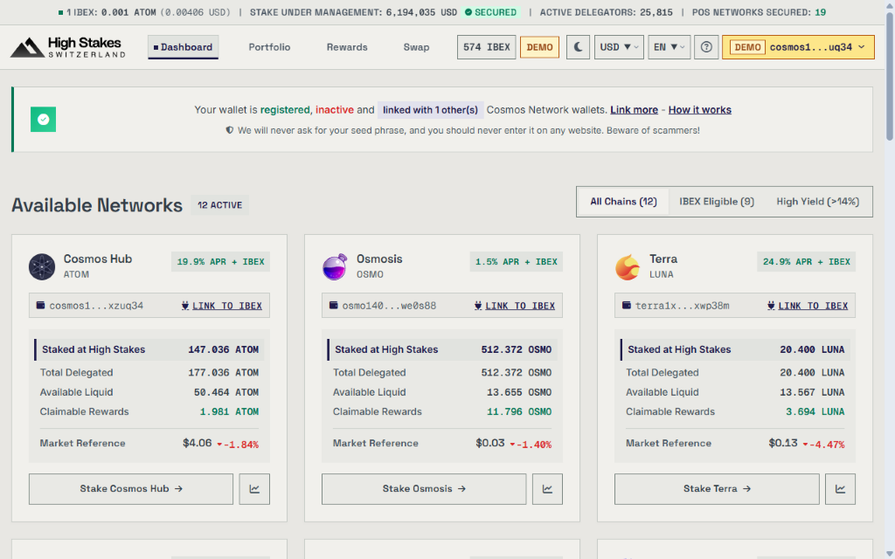
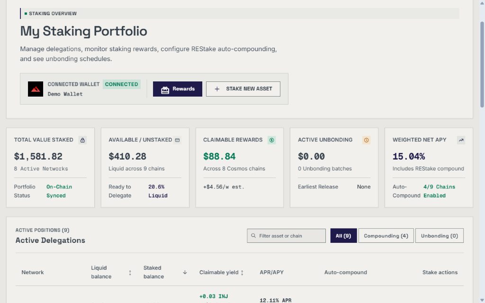

# Introduction

## Prérequis
:::info
* Un portefeuille Cosmos compatible : **Keplr Wallet** (extension navigateur ou application mobile), **Portefeuille mobile** (via WalletConnect / Reown), **MetaMask** (via Cosmos Snap) ou **Compte Réseau Social** (via Web3Auth)
* Un ou plusieurs wallets déléguant au moins **500 $ USD** au total sur les validateurs **High Stakes 🇨🇭** éligibles
:::

## Le Programme de fidélité IBEX

Grâce au **Programme IBEX**, les délégateurs de <a href="https://highstakes.ch" target="_blank">High Stakes Switzerland</a> augmentent leurs rendements de staking en recevant chaque jour une part des revenus générés par nos validateurs sur l'ensemble des chaînes éligibles.

Les points de fidélité IBEX sont distribués quotidiennement aux utilisateurs inscrits, au prorata de la valeur totale en USD des jetons délégués auprès des validateurs High Stakes.

:::tip Points clés du programme
- **Distribution quotidienne** : Vous cumulez des points IBEX chaque jour (attribués entre 15h00 et 15h30 UTC).
- **Échange en `$ATOM` ou en `$USDC`** : Dès que vous détenez au moins **50 IBEX**, vous pouvez les échanger à tout moment depuis l'onglet **Récompenses** (`Rewards`) et choisir de recevoir des **`$ATOM`** ou des **`$USDC`** liquides sur votre portefeuille Cosmos Hub :
  - À partir de **250 IBEX**, l'envoi est immédiat.
  - Entre **50 et 249 IBEX**, l'échange est traité de manière asynchrone via une transaction groupée (*multisend*) exécutée automatiquement dès que le total des demandes atteint 250 IBEX (généralement en moins de deux heures).
- **Taux de conversion** : Le taux de référence est de **1 000 IBEX = 1 ATOM** (`1 IBEX = 0,001 ATOM`), affiché en temps réel dans le bandeau supérieur avec sa contre-valeur en devise (`USD`, `CHF` ou `EUR`).
:::

## Réseaux supportés (12 blockchains)

Sur <a href="https://app.highstakes.ch/dashboard" target="_blank">app.highstakes.ch</a>, vous pouvez filtrer les réseaux via les onglets **Toutes les chaînes (12)**, **Éligibles IBEX (9)** ou **Haut rendement (>14 %)** :

### 9 chaînes éligibles au programme IBEX (Badge `+ IBEX`)
Vos délégations auprès de High Stakes sur ces 9 réseaux sont comptabilisées dans le seuil minimal de 500 $ USD et génèrent des points IBEX quotidiens une fois liées :
1. **Cosmos Hub** (`ATOM`)
2. **Osmosis** (`OSMO`)
3. **Terra 2.0** (`LUNA`)
4. **Secret Network** (`SCRT`)
5. **Injective** (`INJ`)
6. **Fetch.ai** (`FET`)
7. **Band Protocol** (`BAND`)
8. **Shentu** (`CTK`)
9. **Akash Network** (`AKT`)

### 3 chaînes supplémentaires supportées pour le staking
Ces réseaux sont intégralement supportés pour le staking direct dans l'application, le suivi de portefeuille et l'auto-compounding REStake (hors programme IBEX) :
10. **MediBloc / Panacea** (`MED`)
11. **Axone** (`AXONE`)
12. **Provenance** (`HASH`)

## Fonctionnement

1. **Connexion & Inscription** : Connectez votre portefeuille sur <a href="https://app.highstakes.ch" target="_blank">app.highstakes.ch</a> et inscrivez votre compte. Votre compte IBEX est identifié par votre adresse principale **Cosmos Hub** (`cosmos1...`).
2. **Liaison des chaînes éligibles** : Sur le **Tableau de bord**, activez les réseaux sur lesquels vous déléguez et cliquez sur **`LIER À IBEX`** (`LINK TO IBEX`) sur chaque carte réseau afin de rattacher vos délégations à votre compte IBEX.
3. **Seuil de 500 $ USD en staking** : Tout délégateur peut s'inscrire, et l'attribution quotidienne de points IBEX démarre automatiquement dès que l'ensemble de vos délégations liées atteint au moins **500 $ USD**.
   - Une fois inscrit, la bannière de statut en haut du Tableau de bord indique en temps réel votre activité de gain IBEX (**`actif`** si votre compte a généré des IBEX au cours des dernières 48 heures, ou **`inactif`** si votre stake total lié est inférieur à 500 $ USD).
4. **Calcul quotidien équitable** : Le nombre de points IBEX attribués chaque jour évolue selon vos délégations et les taux de change. Une **fonction quadratique** (proportionnelle à la racine carrée du montant en USD délégué, plafonnée à 250 IBEX/jour par compte) garantit que les très gros portefeuilles (« baleines ») ne captent pas une part disproportionnée des récompenses.
5. **Échange à tout moment** : Depuis l'onglet **Récompenses** (`/rewards`), cliquez sur **`Échanger IBEX`** (`Redeem IBEX`) pour recevoir vos récompenses en **`$ATOM`** ou en **`$USDC`**.

**Note importante sur l'expiration des points** : Les points IBEX ont une **durée de validité de 60 jours** — les points obtenus il y a plus de 60 jours expirent s'ils ne sont pas échangés, **uniquement lorsque votre solde disponible dépasse 500 IBEX**. <u>En dessous de 500 IBEX, vos points n'expirent jamais</u>. Nous vous recommandons donc d'échanger vos IBEX au moins une fois tous les deux mois.

## Portefeuille & Gestion de Staking intégrée

En complément du programme de fidélité IBEX, l'application High Stakes propose une vue complète **Portefeuille** (`/overview`) ainsi qu'un panneau de **Gestion de Staking** intégré :

- **Tableau de bord à 5 indicateurs (KPI)** : Suivez votre **Valeur Totale en Staking**, votre solde **Disponible / Non Délégué**, vos **Récompenses Réclamables** (avec estimation hebdomadaire), vos périodes d'**Unbonding Actives** et votre **APY Net Pondéré**.
- **Panneau de Gestion de Staking intégré** : Cliquez sur **`Déléguer sur <Chaîne>`** (`Stake <Chain>`) depuis une carte du Tableau de bord ou sur **`GÉRER`** / **`DÉLÉGUER UN NOUVEL ACTIF`** dans votre Portefeuille pour **Déléguer** (`DELEGATE`), **Redéléguer** (`REDELEGATE`), **Unbond** (`UNBOND`) ou **Annuler un Unbond** (`CANCEL UNBOND`) directement dans l'application.
- **Protection contre le Slashing d'indisponibilité** : High Stakes maintient des portefeuilles de réserve séquestres on-chain autofinancés sur 10 réseaux (vérifiables publiquement en bas du Tableau de bord) afin de couvrir toute pénalité liée à une indisponibilité.

## Support multi-wallets

Pour des raisons de sécurité, de nombreux utilisateurs répartissent leurs actifs sur plusieurs portefeuilles (différentes seed phrases).

Si un utilisateur délègue les montants suivants sur trois portefeuilles distincts :
- **400 $ USD** d'ATOM sur un premier compte,
- **300 $ USD** d'INJ sur un deuxième compte,
- **100 $ USD** de BAND sur un troisième compte,

pris individuellement, aucun de ces comptes n'atteint le seuil requis de 500 $ USD. Toutefois, les participants peuvent **lier leurs différents comptes Cosmos inscrits** afin de cumuler la valeur de toutes leurs délégations :

- **400 $ + 300 $ + 100 $ = 800 $ USD** au total en staking.

Avec un total de 800 $ USD en staking, l'utilisateur dépasse le seuil de 500 $ USD et reçoit chaque jour ses points IBEX sur son portefeuille principal. Consultez la section [Liaison de plusieurs wallets](/loyalty-program/link/) pour découvrir la marche à suivre.

## Récompenser les délégateurs fidèles sur le long terme

Chaque année en décembre, une enveloppe supplémentaire d'ATOM est distribuée à l'ensemble des participants, au prorata des points IBEX gagnés au cours de l'année écoulée et du nombre de jours de délégation auprès de High Stakes.
