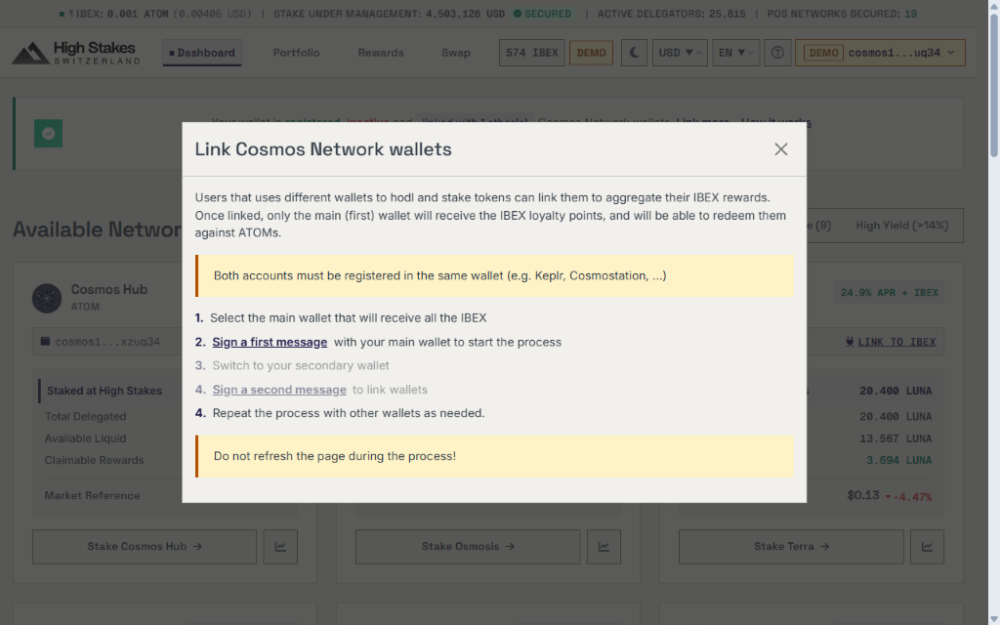
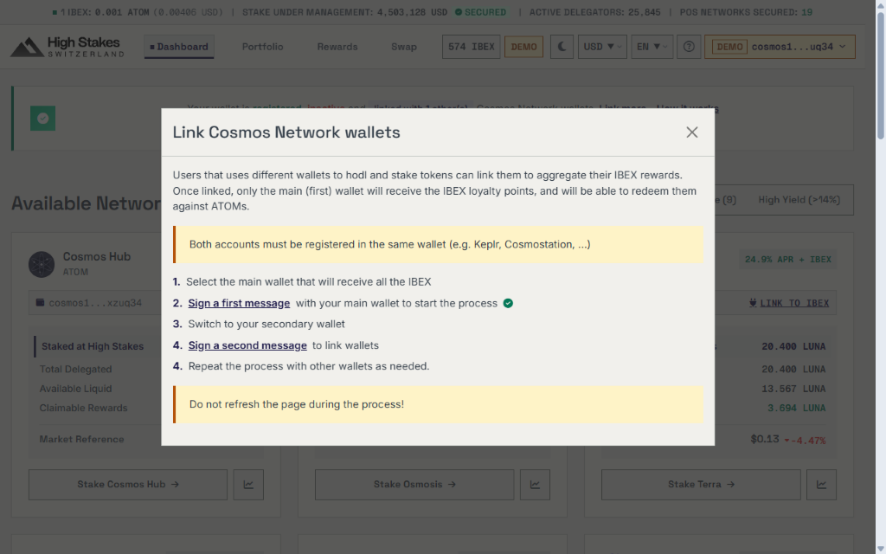

# Liaison de plusieurs wallets

Si vous déléguez depuis plusieurs portefeuilles distincts (différentes seed phrases ou différents comptes), vous pouvez les lier afin de cumuler l'ensemble de vos montants en staking pour le calcul quotidien de vos points IBEX. Cette fonctionnalité est particulièrement utile si chacun de vos portefeuilles possède individuellement moins de **500 $ USD**, le minimum requis pour générer des points IBEX.

Une fois les portefeuilles liés, tous les points IBEX générés sont crédités sur votre **portefeuille principal (le premier)**, depuis lequel vous pourrez les échanger contre des **$ATOM** ou des **$USDC**.

:::info Prérequis
* Les deux portefeuilles doivent être préalablement **inscrits** au programme de fidélité IBEX (et avoir leurs chaînes respectives liées via **`LIER À IBEX`**).
* Les deux comptes doivent être importés dans la même extension de portefeuille (comme **Keplr Wallet** sur ordinateur, ou le navigateur intégré de **Keplr Mobile**) afin de pouvoir basculer du portefeuille principal au portefeuille secondaire sans rafraîchir la page.
:::

## Comment lier vos wallets

1. Connectez votre **portefeuille principal** (celui qui recevra l'ensemble des points IBEX) sur <a href="https://app.highstakes.ch/dashboard" target="_blank">app.highstakes.ch</a>.
2. Dans la bannière verte de statut en haut du **Tableau de bord**, cliquez sur **`lier`** (`link`, ou **`En lier un autre`** / `Link more` si vous avez déjà lié un wallet) pour ouvrir la fenêtre **Lier des wallets Cosmos Network**.
3. Cliquez sur **`Signez un premier message`** (`Sign a first message`, étape 2) et approuvez la signature avec votre portefeuille principal.

4. Une fois la coche verte affichée à l'étape 2, ouvrez votre extension de portefeuille et **passez à votre wallet secondaire** (étape 3). **Ne rafraîchissez surtout pas la page pendant le processus.**
5. Cliquez sur **`Signez un deuxième message`** (`Sign a second message`, étape 4) et approuvez la signature avec votre portefeuille secondaire pour confirmer la liaison.

6. Un message de confirmation vous indique que vos deux portefeuilles sont désormais liés ! Vous pouvez répéter l'opération pour lier d'autres portefeuilles si nécessaire. 🚀

:::tip Consulter vos portefeuilles liés
Une fois vos comptes liés, la bannière de statut du Tableau de bord affiche un badge **`lié avec X autre(s)`**. Survolez (ou touchez) ce badge à tout moment pour afficher la liste complète des adresses Cosmos associées à votre compte.
:::

Si vous avez des questions ou besoin d'aide, n'hésitez pas à nous contacter sur [Discord](https://discord.gg/Rw4YswvKVa) ou [Telegram](https://t.me/HighStakesSwitzerland).
