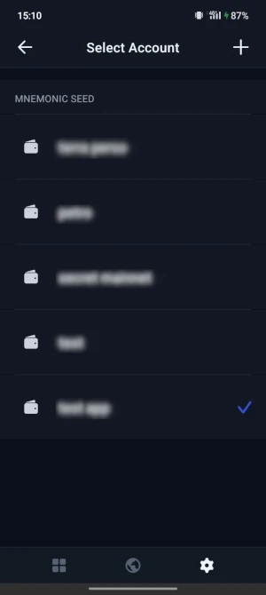
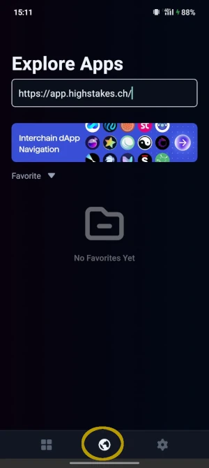
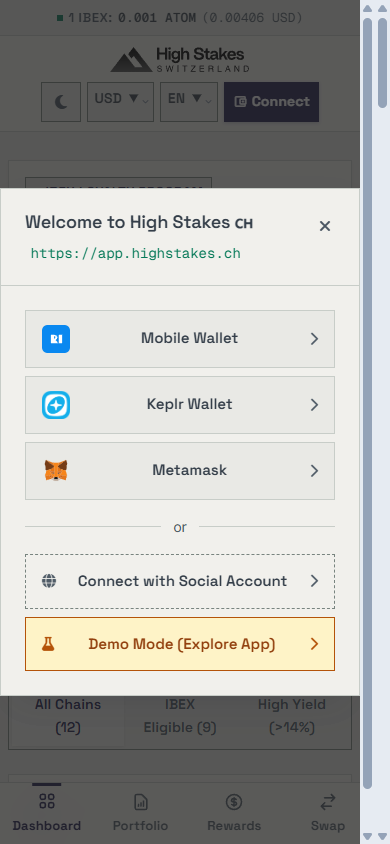
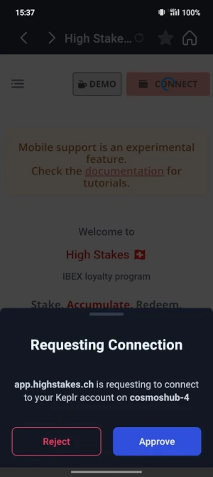
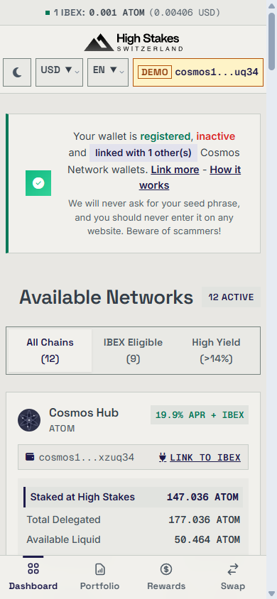

# Support Mobile & Portefeuilles Alternatifs

`app.highstakes.ch` dispose d'une interface mobile responsive dotée d'une barre de navigation inférieure dédiée (**Dashboard**, **Portfolio**, **Rewards**, **Swap**) et propose plusieurs méthodes de connexion sur mobile et ordinateur.

## Méthodes de connexion sur mobile

:::info Parcours mobiles supportés
1. **Portefeuille mobile (WalletConnect / Reown)** : Ouvrez <a href="https://app.highstakes.ch" target="_blank">https://app.highstakes.ch</a> dans votre navigateur mobile (Safari, Chrome, Brave) ou sur ordinateur, appuyez sur **Connexion** (`Connect`) puis choisissez **Portefeuille mobile** (`Mobile Wallet`) pour vous connecter par lien profond ou QR code WalletConnect v2 / Reown.
2. **Navigateur intégré de Keplr Mobile** : Ouvrez <a href="https://app.highstakes.ch" target="_blank">https://app.highstakes.ch</a> directement depuis le navigateur intégré de l'application <a href="https://www.keplr.app/download" target="_blank">Keplr Mobile</a> et sélectionnez **Keplr Wallet**.
3. **Connexion via Réseau Social (Web3Auth)** : Appuyez sur **Connexion** -> **Connexion via Réseau Social** (`Connect with Social Account`) pour vous connecter avec un compte social depuis n'importe quel appareil.
:::

## Option 1 : Utiliser le navigateur intégré de Keplr Mobile

1. Dans l'application **Keplr Mobile**, sélectionnez le portefeuille que vous souhaitez utiliser :

2. Ouvrez l'onglet **Navigateur** (icône globe) en bas de l'application, saisissez l'URL `https://app.highstakes.ch` et validez :

3. Appuyez sur le bouton **Connexion** (`Connect`) en haut à droite, sélectionnez **Keplr Wallet** (ou **Portefeuille mobile**) et acceptez la demande d'accès :

4. Vous êtes connecté ! Utilisez la barre de navigation en bas de l'écran pour naviguer entre **Dashboard**, **Portfolio**, **Rewards** et **Swap**, et ajoutez la page à vos favoris pour un accès rapide :

## Option 2 : Connexion via Portefeuille mobile (WalletConnect / Reown)

Si vous préférez utiliser le navigateur web standard de votre smartphone (ou connecter votre portefeuille mobile à une session sur ordinateur) :

1. Rendez-vous sur <a href="https://app.highstakes.ch" target="_blank">https://app.highstakes.ch</a> et appuyez sur **Connexion** (`Connect`).
2. Sélectionnez **Portefeuille mobile** (`Mobile Wallet`) en haut de la fenêtre de connexion.
3. Sur smartphone, ouvrez votre application de portefeuille via le lien direct ; sur ordinateur, scannez le QR code affiché depuis votre application mobile et approuvez la connexion.

:::caution Liaison de plusieurs wallets sur mobile
La liaison de deux portefeuilles Cosmos distincts nécessite de changer de compte en cours de session. Les connexions mobiles WalletConnect / Reown ne permettant pas de changer de compte à la volée sans interrompre la session, nous vous recommandons d'effectuer cette étape unique depuis l'**extension navigateur Keplr sur ordinateur** (ou depuis le navigateur intégré de **Keplr Mobile** en changeant de compte dans l'application avant de revenir sur l'onglet du navigateur).
:::
