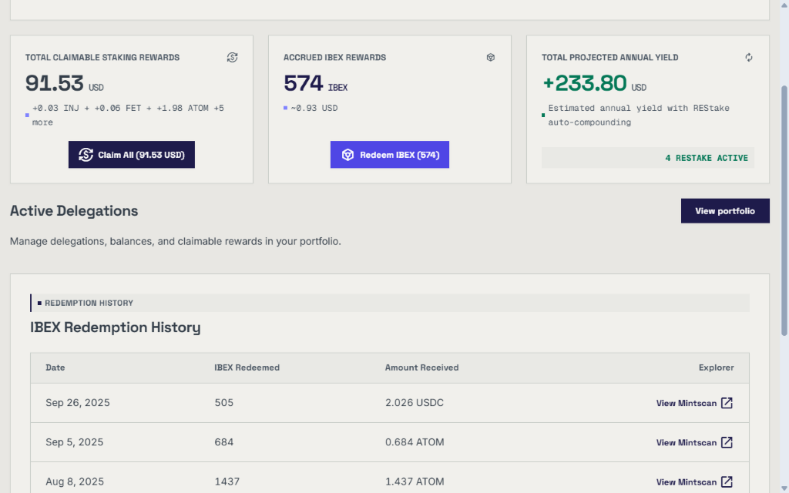
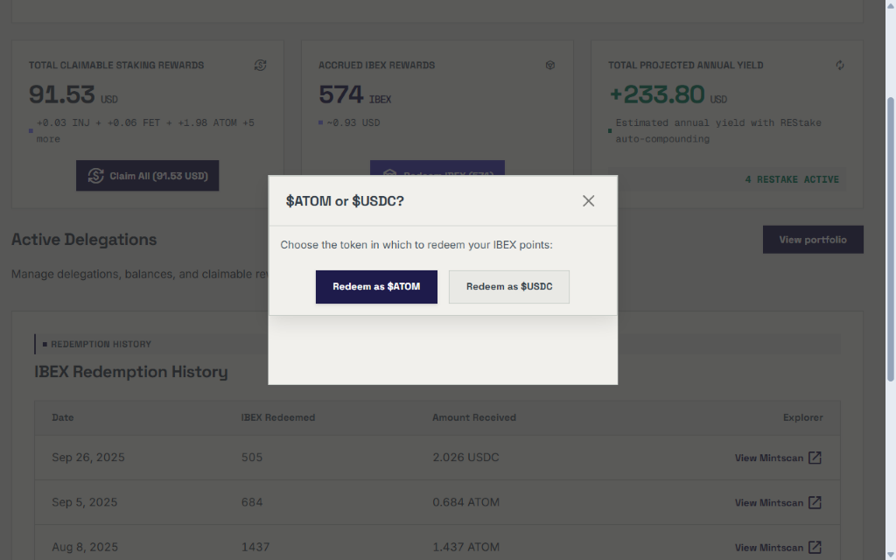

# Échange de vos points IBEX & Réclamation des récompenses

L'onglet **Récompenses** (`/rewards`) vous permet à la fois de réclamer en un clic vos récompenses de staking on-chain sur l'ensemble des réseaux connectés et d'échanger vos points de fidélité **IBEX** contre des **`$ATOM`** ou des **`$USDC`**.

## 1. Accéder à l'onglet « Récompenses » (`Rewards`)

Dès que vous disposez d'au moins **50 IBEX**, cliquez sur l'onglet **Rewards** (`Récompenses`) dans la barre de navigation supérieure (ou cliquez directement sur votre **badge de solde IBEX** dans l'en-tête).

La page **Récompenses** regroupe trois cartes récapitulatives ainsi que votre historique de transactions :
- **Total des récompenses de staking réclamables (`Total Claimable Staking Rewards`)** : Affiche la valeur totale et le détail par jeton de vos récompenses de staking en attente sur toutes vos chaînes connectées. Cliquez sur **`Tout réclamer`** (`Claim All`) pour retirer vos récompenses de staking en une seule opération.
- **Récompenses IBEX accumulées (`Accrued IBEX Rewards`)** : Affiche votre solde IBEX disponible et sa contre-valeur estimée. Dès que votre solde atteint **50 IBEX ou plus**, le bouton **`Échanger IBEX (<montant>)`** (`Redeem IBEX`) s'active (en dessous de 50 IBEX, le badge `MIN. 50 IBEX REQUIS` est affiché).
- **Rendement annuel projeté total (`Total Projected Annual Yield`)** : Indique votre rendement annuel estimé avec l'auto-compounding REStake ainsi que le nombre de chaînes disposant d'une autorisation REStake active.
- **Historique des échanges IBEX (`IBEX Redemption History`)** : Un tableau paginé répertoriant tous vos échanges passés (Date, IBEX échangés, montant reçu en `ATOM` ou `USDC`, et lien direct **Voir sur Mintscan**).

## 2. Choisir `$ATOM` ou `$USDC` et confirmer l'échange

1. Cliquez sur le bouton **`Échanger IBEX (<montant>)`** (`Redeem IBEX`) dans la carte **Accrued IBEX Rewards**.
2. La fenêtre **`$ATOM ou $USDC?`** s'ouvre pour vous permettre de choisir le jeton dans lequel recevoir vos récompenses :
   - Cliquez sur **`Échanger en $ATOM`** (`Redeem as $ATOM`) pour recevoir des `ATOM` sur Cosmos Hub.
   - Cliquez sur **`Échanger en $USDC`** (`Redeem as $USDC`) pour recevoir des `USDC`.
3. Approuvez la signature gratuite dans votre portefeuille pour valider la demande d'échange.

## 3. Réception de vos jetons

Une barre de progression en 3 étapes suit le traitement de votre demande (`Demande de signature...` -> `Envoi de la transaction...` -> `Transaction en cours de validation...`) :

- **À partir de 250 IBEX (Échange immédiat)** : La transaction est exécutée immédiatement et vos `$ATOM` ou `$USDC` arrivent sur votre portefeuille Cosmos en quelques secondes, avec un lien direct vers la transaction sur **Mintscan**.
- **De 50 à 249 IBEX (Échange asynchrone groupé)** : L'interface vous permet d'échanger dès 50 IBEX ; votre demande est regroupée avec d'autres opérations dans une transaction *multisend* exécutée automatiquement dès que le total cumulé dépasse 250 IBEX (généralement en moins de deux heures).

## 4. Échanges interchaînes (`/swap`)

Vous souhaitez convertir vos récompenses de staking ou vos `$ATOM` / `$USDC` vers un autre actif de l'écosystème Cosmos ?
Rendez-vous dans l'onglet **Swap** (`/swap`) de la barre de navigation pour utiliser le module intégré **Atom Circuit Swap** (propulsé par la liquidité du DEX Osmosis et Cosmosrescue) directement depuis `app.highstakes.ch`.
