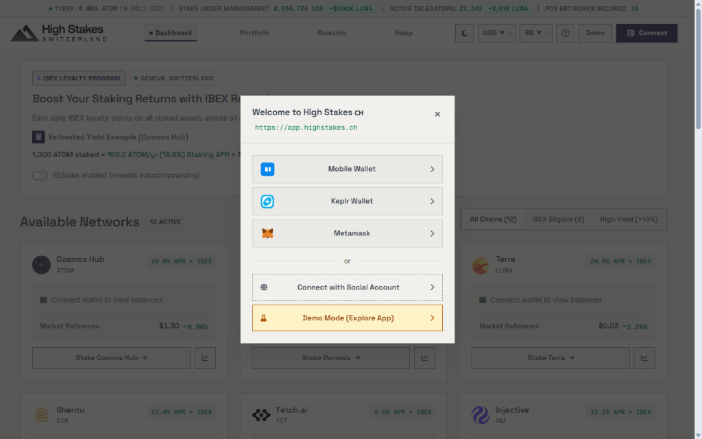
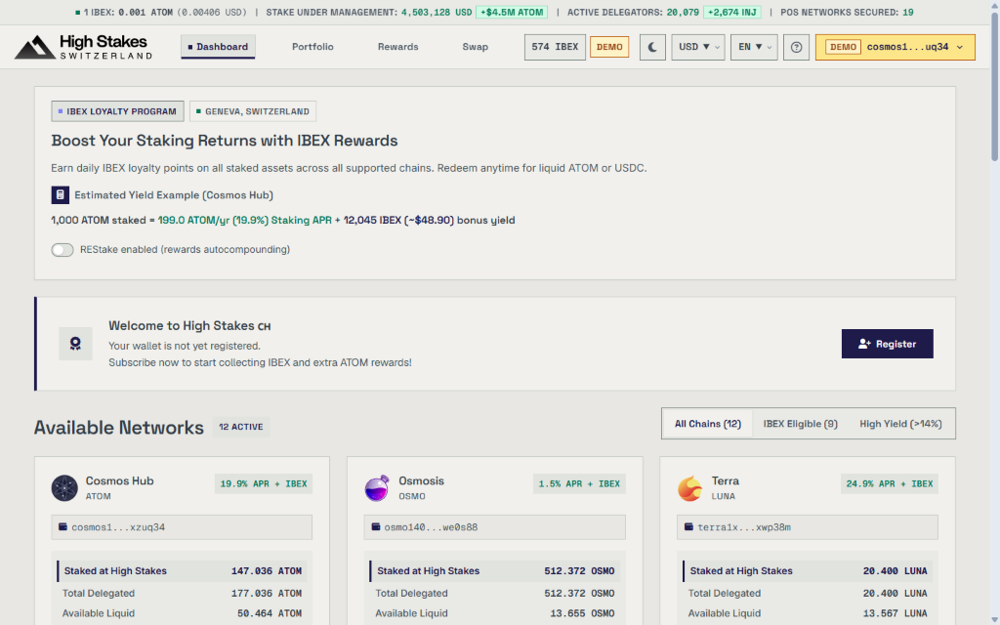
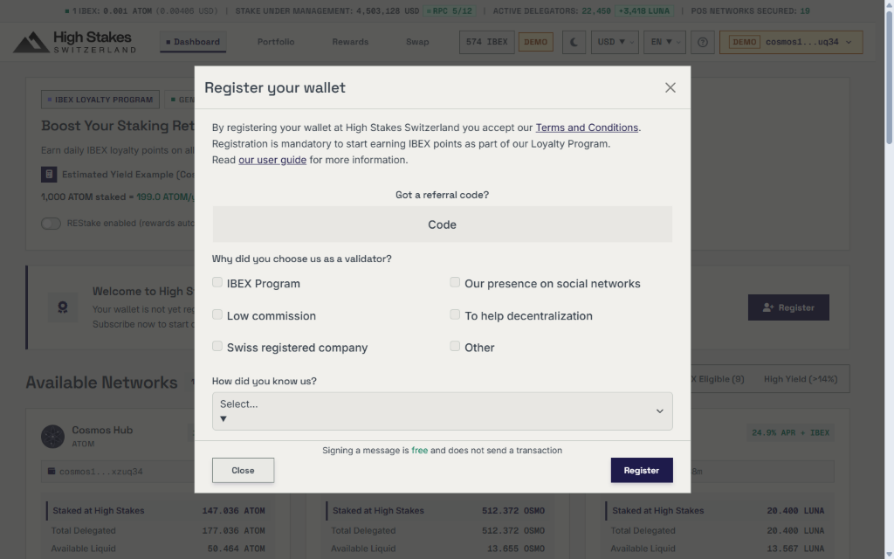
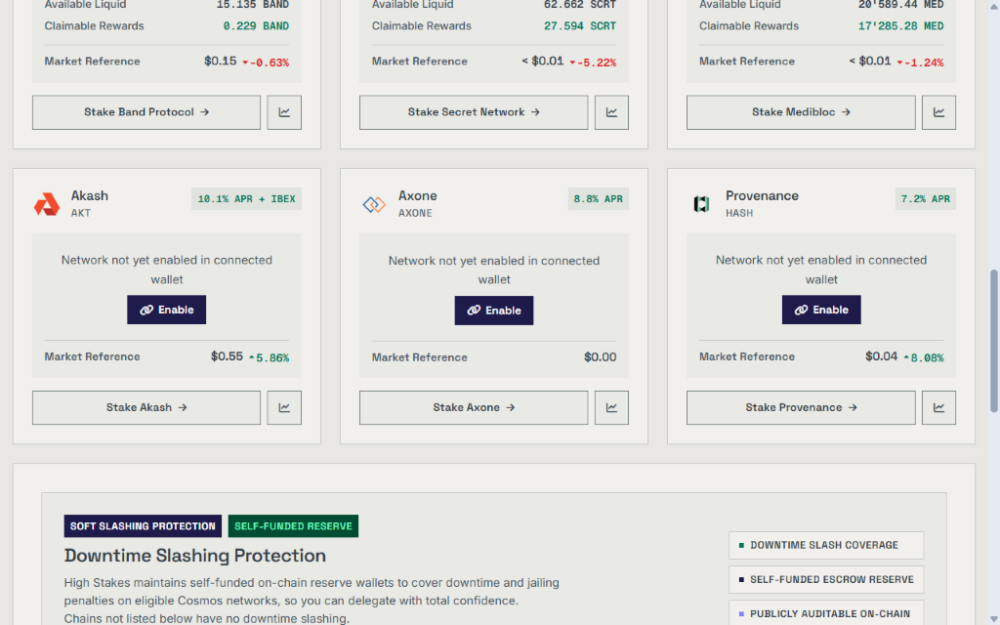
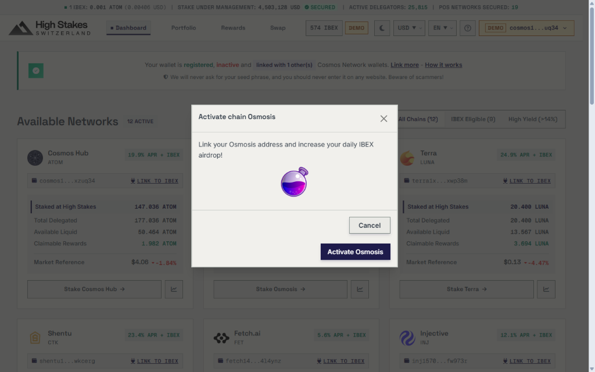
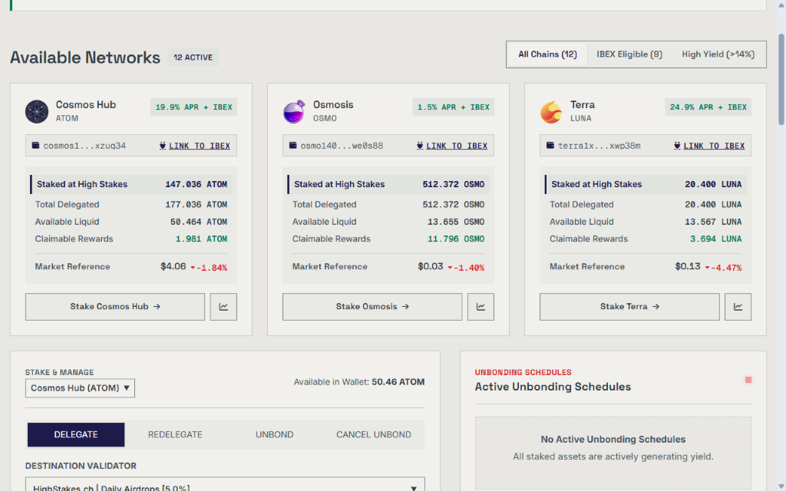

# Inscription & Liaison des chaînes

## 1. Connexion de votre portefeuille

Pour commencer, rendez-vous sur <a href="https://app.highstakes.ch" target="_blank">https://app.highstakes.ch</a> et cliquez sur le bouton **Connexion** (`Connect`) en haut à droite de l'en-tête.

Dans la fenêtre **High Stakes 🇨🇭** (`Welcome to High Stakes 🇨🇭`), choisissez votre méthode de connexion :
- **Portefeuille mobile (`Mobile Wallet`)** : Connectez n'importe quel portefeuille mobile compatible WalletConnect v2 / Reown par QR code ou lien profond.
- **Keplr Wallet** : Connectez-vous via l'extension navigateur Keplr (compatible avec les portefeuilles matériels Ledger, y compris sur Injective).
- **Metamask** : Connectez-vous avec MetaMask grâce à l'intégration Leap Cosmos Snap.
- **Connexion via Réseau Social (`Connect with Social Account`)** : Connectez-vous à l'aide d'un compte social via Web3Auth.
- **Mode Démo (`Demo Mode (Explore App)`)** : Explorez l'intégralité de l'application en lecture seule avec des données de démonstration (également accessible via le bouton **Démo** dans l'en-tête).

:::tip Préférences d'affichage
Depuis la barre d'en-tête en haut à droite, vous pouvez basculer entre le **thème clair et le thème sombre**, choisir votre devise d'affichage (**`USD`**, **`CHF`** ou **`EUR`**) et changer la langue de l'interface (**`EN`** / **`FR`**).
:::

## 2. Inscription de votre portefeuille

Une fois votre portefeuille connecté, s'il n'est pas encore inscrit au programme de fidélité IBEX, une bannière **Bienvenue chez High Stakes 🇨🇭** s'affiche sous la présentation du programme IBEX. Cliquez sur le bouton **Inscription** (`Register`) pour ouvrir la fenêtre d'enregistrement.

Dans la fenêtre **Enregistrez votre wallet** (`Register your wallet`) :
1. Prenez connaissance de nos **Conditions Générales d'Utilisation**.
2. *(Optionnel)* Si vous disposez d'un code de parrainage, saisissez-le dans le champ **Vous avez un code de parrainage ?** (`Got a referral code?`). Si vous avez ouvert l'application via un lien `?referralCode=...`, ce champ est pré-rempli automatiquement.
3. *(Optionnel)* Répondez au court questionnaire pour nous indiquer pourquoi vous avez choisi High Stakes et comment vous nous avez connus.
4. Cliquez sur **S'inscrire** (`Register`) et signez le message de preuve de propriété dans votre portefeuille.

:::tip Signer un message est 100 % gratuit
La signature d'un message de vérification avec votre portefeuille est **gratuite**, ne présente aucun risque et n'envoie aucune transaction sur la blockchain (aucuns frais de gaz).
:::

Une fois inscrit, la bannière supérieure devient verte et affiche le statut en direct de votre activité de gain IBEX (**`inscrit, actif`** ou **`inscrit, inactif`**) ainsi que le nombre de portefeuilles liés.

## 3. Activation des réseaux & Liaison à IBEX

Sous la bannière de statut, la section **Réseaux Disponibles** (`Available Networks`) affiche les **12 blockchains supportées** (avec des filtres **Toutes les chaînes (12)**, **Éligibles IBEX (9)** et **Haut rendement (>14 %)**).

### Activer des réseaux supplémentaires dans votre wallet
Si un réseau n'est pas encore activé dans votre portefeuille connecté (par exemple Akash, Axone ou Provenance), cliquez sur le bouton **Activer** (`Enable`) sur sa carte et approuvez la demande d'ajout dans votre wallet afin d'afficher vos soldes.

### Lier les chaînes éligibles au programme IBEX (`LIER À IBEX`)
Pour que vos délégations sur les autres réseaux éligibles (Osmosis, Terra 2.0, Secret Network, Injective, Fetch.ai, Band Protocol, Shentu ou Akash) soient prises en compte dans le calcul quotidien de vos points IBEX :

1. Repérez la carte du réseau concerné et cliquez sur le bouton **`LIER À IBEX`** (`LINK TO IBEX`) à côté de l'adresse de votre wallet.
2. Dans la fenêtre **Activer la chaîne**, cliquez sur **`Activer <Chaîne>`** (`Activate <Chain>`).
3. Approuvez les deux signatures de preuve de propriété dans votre portefeuille (associant votre adresse sur cette chaîne à votre compte IBEX Cosmos Hub principal).

Une fois l'opération validée, la carte affiche un badge vert **`LIÉ`** (`LINKED`) et vos montants délégués auprès de High Stakes sur cette chaîne sont immédiatement comptabilisés pour vos récompenses quotidiennes IBEX ! 🎉

## 4. Déléguer directement depuis le Tableau de bord

Vous pouvez également déléguer ou gérer vos positions sur n'importe quel réseau directement depuis sa carte :
- Cliquez sur **`Déléguer sur <Chaîne>`** (`Stake <Chain>`) en bas d'une carte réseau pour ouvrir le panneau de **Gestion de Staking** intégré juste en dessous de la ligne.
- Choisissez **DÉLÉGUER** (`DELEGATE`), **REDÉLÉGUER** (`REDELEGATE`), **UNBOND** ou **ANNULER UNBOND** (`CANCEL UNBOND`), saisissez le montant souhaité (ou utilisez les boutons `25%`, `50%`, `75%`, `MAX`) et confirmez la transaction.

